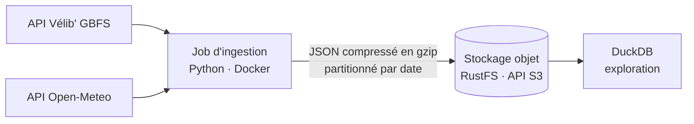
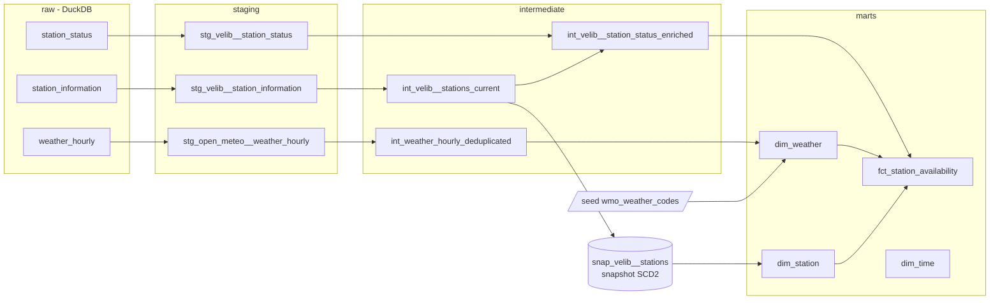
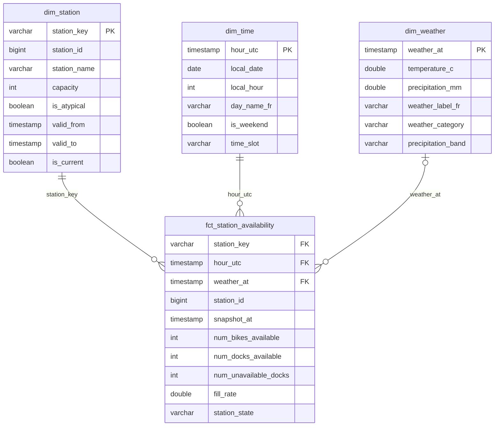

# Vélib' Analytics

Projet de data engineering de bout en bout sur les données des vélos en libre-service parisiens.

**Question métier :** quelles stations Vélib' sont vides ou pleines, à quelles heures, dans quels
quartiers, et quel est l'impact de la météo sur la disponibilité ?

> 🚧 Projet en cours — la semaine 1 (ingestion et stockage brut) est terminée.
> Voir la [feuille de route](#feuille-de-route).

## Architecture



Un job d'ingestion tourne toutes les 10 minutes. Il appelle deux API publiques et enregistre
leurs réponses brutes, sans les modifier et compressées, dans un stockage objet compatible S3.

## Sources de données

| Source | API | Contenu | Format |
|---|---|---|---|
| `station_status` | Vélib' GBFS | Vélos disponibles (mécaniques / électriques) et places libres, en temps réel | Un objet par station |
| `station_information` | Vélib' GBFS | Référentiel des stations : nom, coordonnées, capacité | Un objet par station |
| `weather_hourly` | Open-Meteo | Météo horaire à Paris : température, précipitations, vent, code météo | Une liste par variable |

Les deux API sont gratuites et ne demandent pas de clé.

## Organisation des données brutes

```
s3://velib-raw/raw/<domain>/<source>/dt=YYYY-MM-DD/<source>_YYYYMMDDTHHMMSSZ.json.gz
```

Exemple : `raw/velib/station_status/dt=2026-11-24/station_status_20261124T154500Z.json.gz`

## Outils

| Couche | Outil | Pourquoi |
|---|---|---|
| Ingestion | Python, `requests`, `boto3` | Simple, typé et testable |
| Packaging | Docker, Docker Compose | Le même environnement partout |
| Stockage brut | RustFS (compatible S3) | Remplace AWS S3 en local ; MinIO ne publie plus d'images Docker |
| Exploration | DuckDB | Interroge directement le JSON compressé sur S3 |

## Démarrage

Prérequis : Docker avec Compose v2, et Python 3.11 ou plus (seulement pour le développement local).

```bash
cp .env.example .env              # puis mettre un secret solide : openssl rand -hex 24
docker compose up -d --build      # stockage objet + ingestion toutes les 10 minutes
docker compose logs -f ingestion-scheduler
```

- Console du stockage : http://localhost:9001 (identifiants du fichier `.env`)
- Lancer une seule source, une fois : `docker compose run --rm ingestion station_status`

### Développement local (sans Docker)

```bash
python3 -m venv env && source env/bin/activate
pip install -r requirements.txt
python -m ingestion.main                    # écrit dans ./data/raw (STORAGE_BACKEND=local)
```

## Structure du projet

```
velib-analytics/
├── ingestion/
│   ├── main.py          # point d'entrée : lance chaque source, renvoie le code de sortie
│   ├── sources.py       # catalogue des API et de leurs règles de validation
│   ├── storage.py       # interface Storage : disque local ou S3
│   └── common.py        # session HTTP avec retries, logs, noms des objets
├── explore_api.py       # première exploration de l'API Vélib'
├── explore_weather.py   # première exploration de l'API Open-Meteo
├── explore_duckdb.py    # exploration SQL des fichiers bruts sur S3
├── Dockerfile
├── docker-compose.yml
├── requirements.txt
└── .env.example
```

## Transformation (dbt)

Les données brutes chargées dans DuckDB sont transformées avec **dbt** (`transform/`), en trois couches et un modèle en étoile.

### Lignage



| Couche | Rôle | Matérialisation |
|---|---|---|
| `staging` | Une vue par source : extraction du JSON, typage, renommage. Tout l'historique est conservé. | vue |
| `intermediate` | Logique métier : dédoublonnage de la météo, référentiel courant des stations, états et taux de remplissage. | vue |
| `marts` | Modèle en étoile pour l'analyse et le dashboard. | table |
| `snapshots` | Historique des stations (SCD de type 2). | table (à état) |

### Modèle en étoile



**Grain du fait** : une ligne par station et par instantané (environ toutes les 30 minutes, soit environ 73 000 lignes par jour).

### Choix de modélisation

- **Tout en UTC, heure de Paris seulement dans `dim_time`.** L'UTC ne change pas d'heure, donc aucune clé n'est en double ni manquante. Le comportement des usagers suit l'heure locale : les créneaux (`morning_peak`, `evening_peak`…) sont donc calculés en Europe/Paris. Les jours de changement d'heure ont bien 23 ou 25 heures.
- **Stations historisées en SCD de type 2** avec un snapshot dbt (stratégie `check` sur les seuls attributs métier). Le fait est joint à la version valide au moment de l'observation, sur un intervalle semi-ouvert `valid_from <= t < valid_to`. La première version couvre toute la période d'observation passée.
- **Le staging garde toutes les versions**, le dédoublonnage se fait dans l'intermediate : on peut toujours retrouver d'où vient une valeur.
- **Les stations atypiques sont marquées, jamais filtrées** (capacité nulle, codes spéciaux en 6xxxx, capacité supérieure à un seuil paramétrable). La règle est écrite une seule fois, dans une macro.
- **Les codes météo WMO sont dans un seed** testé : un code inconnu fait échouer le build.
- **Le fait est une table reconstruite, pas un modèle incrémental** : avec ce volume, DuckDB la reconstruit en quelques secondes. Le passage en incrémental est prévu quand le temps de build le justifiera.

### Qualité des données

`<N>` tests au total, lancés par `dbt build` :

- **Unicité et non-nullité** des clés, y compris le grain du fait (`station_id` + `snapshot_at`).
- **Intégrité référentielle** entre le fait et les trois dimensions, et vers le seed WMO.
- **Règles métier** : bornes de valeurs, valeurs autorisées, cohérence vélos mécaniques + électriques = total.
- **SCD2** : une seule version courante par station, et aucun chevauchement de périodes (test singulier).
- **Continuité** des heures météo et de la dimension temps.
- **Fraîcheur des sources** (`dbt source freshness`) : alerte après 1 h, erreur après 3 h.

### Lancer la transformation

```bash
cd transform
pip install -r requirements.txt
dbt deps                 # installs dbt_utils
dbt seed                 # loads WMO weather codes
dbt snapshot             # records station changes (SCD2)
dbt build                # models + tests
dbt docs generate && dbt docs serve --host 127.0.0.1 --port 8080
```


## Feuille de route

- [x] **Semaine 1** — Ingestion, stockage brut, Docker, exploration avec DuckDB
- [x] **Semaine 2** — Modèles dbt (staging / intermediate / marts), schéma en étoile, tests, documentation
- [ ] **Semaine 3** — DAGs Airflow (à la place de l'ordonnanceur provisoire), dashboard Metabase
- [ ] **Semaine 4** — CI avec GitHub Actions, migration cloud, Terraform