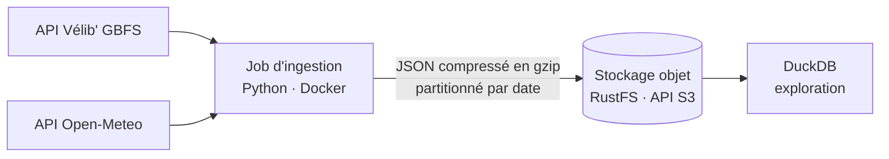

# Vélib' Analytics

Projet de data engineering de bout en bout sur les données des vélos en libre-service parisiens.

**Question métier :** quelles stations Vélib' sont vides ou pleines, à quelles heures, dans quels
quartiers, et quel est l'impact de la météo sur la disponibilité ?

> 🚧 Projet en cours — la semaine 1 (ingestion et stockage brut) est terminée.
> Voir la [feuille de route](#feuille-de-route).

## Architecture



Un job d'ingestion tourne toutes les 10 minutes. Il appelle deux API publiques et enregistre
leurs réponses brutes, sans les modifier et compressées, dans un stockage objet compatible S3.

## Sources de données

| Source | API | Contenu | Format |
|---|---|---|---|
| `station_status` | Vélib' GBFS | Vélos disponibles (mécaniques / électriques) et places libres, en temps réel | Un objet par station |
| `station_information` | Vélib' GBFS | Référentiel des stations : nom, coordonnées, capacité | Un objet par station |
| `weather_hourly` | Open-Meteo | Météo horaire à Paris : température, précipitations, vent, code météo | Une liste par variable |

Les deux API sont gratuites et ne demandent pas de clé.

## Organisation des données brutes

```
s3://velib-raw/raw/<domain>/<source>/dt=YYYY-MM-DD/<source>_YYYYMMDDTHHMMSSZ.json.gz
```

Exemple : `raw/velib/station_status/dt=2026-11-24/station_status_20261124T154500Z.json.gz`

## Outils

| Couche | Outil | Pourquoi |
|---|---|---|
| Ingestion | Python, `requests`, `boto3` | Simple, typé et testable |
| Packaging | Docker, Docker Compose | Le même environnement partout |
| Stockage brut | RustFS (compatible S3) | Remplace AWS S3 en local ; MinIO ne publie plus d'images Docker |
| Exploration | DuckDB | Interroge directement le JSON compressé sur S3 |

## Démarrage

Prérequis : Docker avec Compose v2, et Python 3.11 ou plus (seulement pour le développement local).

```bash
cp .env.example .env              # puis mettre un secret solide : openssl rand -hex 24
docker compose up -d --build      # stockage objet + ingestion toutes les 10 minutes
docker compose logs -f ingestion-scheduler
```

- Console du stockage : http://localhost:9001 (identifiants du fichier `.env`)
- Lancer une seule source, une fois : `docker compose run --rm ingestion station_status`

### Développement local (sans Docker)

```bash
python3 -m venv env && source env/bin/activate
pip install -r requirements.txt
python -m ingestion.main                    # écrit dans ./data/raw (STORAGE_BACKEND=local)
```

## Structure du projet

```
velib-analytics/
├── ingestion/
│   ├── main.py          # point d'entrée : lance chaque source, renvoie le code de sortie
│   ├── sources.py       # catalogue des API et de leurs règles de validation
│   ├── storage.py       # interface Storage : disque local ou S3
│   └── common.py        # session HTTP avec retries, logs, noms des objets
├── explore_api.py       # première exploration de l'API Vélib'
├── explore_weather.py   # première exploration de l'API Open-Meteo
├── explore_duckdb.py    # exploration SQL des fichiers bruts sur S3
├── Dockerfile
├── docker-compose.yml
├── requirements.txt
└── .env.example
```

## Feuille de route

- [x] **Semaine 1** — Ingestion, stockage brut, Docker, exploration avec DuckDB
- [ ] **Semaine 2** — Modèles dbt (staging / intermediate / marts), schéma en étoile, tests, documentation
- [ ] **Semaine 3** — DAGs Airflow (à la place de l'ordonnanceur provisoire), dashboard Metabase
- [ ] **Semaine 4** — CI avec GitHub Actions, migration cloud, Terraform